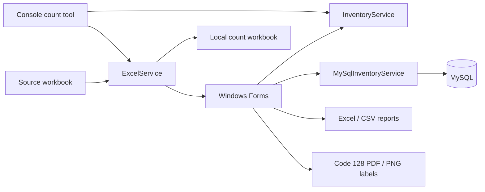

# Architecture and inventory behavior

MNInventory separates the Windows Forms interface from the models, inventory rules, and persistence services in `MNInventoryApp`. The core project also contains a console entry point for workbook-based counting.



## Responsibilities

| Area | Responsibility |
| --- | --- |
| `Models/` | Product values, computed adjustments, scan-history records, and report rows. |
| `InventoryService` | Barcode lookup, slash-separated barcode aliases, counted-quantity updates, summaries, and unscanned reports. |
| `ExcelService` | Source-workbook import, count-workbook loading, and Excel export. |
| `MySqlInventoryService` | Catalog synchronization, counted totals, transactional updates, history, and session reset. |
| Windows Forms | Input validation, keyboard workflow, reports, product entry, and scan undo controls. |
| `BarcodeLabelExportService` | Code 128 rendering and page layouts for PDF/PNG labels. |

The database layer uses parameterized MySQL commands. Count updates and their corresponding history entries are written within transactions. Each persisted history entry records an action, quantity, time, scanned barcode, and computer name; this identifies the originating computer rather than an authenticated person.

## Data model

`source_products` holds product identity, SKU, barcode aliases, expected inventory, and active status. `scanned_products` stores the counted total for a source product. `scan_history` records scan/import/undo activity linked to the source product.

For a counted product:

```text
Adjustment = Counted - SystemInventory
```

The discrepancy view operates on counted products. The separate unscanned report includes active source products with expected inventory greater than one that have no matching scanned barcode. It deliberately applies that threshold, so it is not a list of every untouched catalog row.

## Barcode and count lifecycle

Product barcodes are stored as text. Multiple aliases may be separated with `/`. A barcode dictionary expands those aliases for lookup. If one barcode is assigned to conflicting product identities, lookup rejects that ambiguous token instead of selecting an arbitrary product.

A scan adds a positive quantity to a product and records history. Quick Scan fixes that quantity at one. The main window's undo stack belongs to the running application session; persisted history supplies additional review and undo controls. Selected-history and computer-wide undo operations affect the shared database.

Source-workbook synchronization first matches catalog products by SKU, then falls back to a shared barcode alias, and preserves their counted totals. Products absent from the new source become inactive. Restoring a scanned workbook uses the same matching rules, replaces the current counted rows, and rebuilds import history. Starting a new count clears count rows and history while retaining the catalog.

## Scope

The desktop app uses MySQL as shared storage and loads data through synchronous service calls. Views refresh when their workflows reload data; there is no push notification channel between clients. The console tool reads and writes workbooks independently of the database. Evaluate database connectivity, multiple-client behavior, and report printing in the environment where you intend to run the application.
